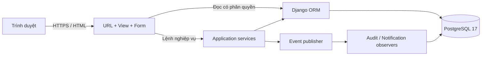

# Thiết kế hệ thống

## 1. Kiến trúc

Ứng dụng dùng kiến trúc Django đơn khối có phân lớp. Trình duyệt nhận HTML render phía server, CSS/JS local; chỉ khung giờ dùng fetch JSON. Quyết định này giữ việc cài đặt và triển khai đơn giản, không cần đồng bộ hai hệ xác thực frontend/backend.



- `models.py`: cấu trúc lưu trữ, ràng buộc và thuộc tính tính toán.
- `forms.py`: kiểm tra định dạng dữ liệu, lọc lựa chọn theo người dùng.
- `views.py`: xác thực, quyền trên đối tượng, truy vấn hiển thị, HTTP, CSV.
- `services.py`: lệnh đặt lịch/chuyển trạng thái có transaction, khóa và tái kiểm tra.
- `events.py`: Publisher thông báo các Observer trong cùng transaction; không cần Redis/Celery.
- `admin.py`: giao diện quản trị nguồn lực; lịch và hóa đơn chỉ đọc để tránh bỏ qua nghiệp vụ.

## 2. Mô hình use case


Nguồn: thiết kế từ yêu cầu và mã triển khai. Đây là sơ đồ use case biểu diễn bằng Mermaid flowchart (không thay thế ký pháp UML đầy đủ). Mỗi quyền chi nhánh được thực thi ở server, không chỉ ẩn nút trong giao diện.

## 3. Mô hình dữ liệu quan hệ


PostgreSQL lưu Unicode bằng `varchar/text`, thời gian bằng `timestamptz`. Tất cả bảng nghiệp vụ có `id bigint` làm khóa chính. Các trường bắt buộc không nhận NULL trừ khi ghi rõ. Tên bảng thực tế có tiền tố `salon_`. Django còn quản lý các bảng auth, group, permission, session và admin log.

### 3.1 Từ điển dữ liệu

| Bảng | Các trường chính | Ràng buộc và ý nghĩa |
|---|---|---|
| User | username varchar(150), password varchar(128), full_name varchar(100), phone varchar(10), email varchar(254), role varchar(20), branch_id FK nullable, points integer, is_active, is_staff, is_superuser, date_joined | Username unique; phone theo mẫu 10 số; role customer/receptionist/manager; password lưu hash; điểm không âm. Kế thừa thêm trường chuẩn AbstractUser |
| Branch | name varchar(100), address varchar(250), phone varchar(10), opens_at time, closes_at time, active boolean | Tên unique; đóng sau mở; không hỗ trợ ca mở qua nửa đêm |
| Service | name varchar(100), description text, kind varchar(10), price integer, duration integer, active boolean | Giá >=1.000 VNĐ; thời lượng 15–240 phút; kind hair/care/combo; tên unique |
| Employee | name varchar(100), branch_id FK, specialty varchar(150), bio varchar(250), active boolean | Stylist thuộc đúng một chi nhánh; lịch sử không đổi chi nhánh qua Admin |
| Chair | branch_id FK, name varchar(30), active boolean | Unique (branch_id, name); không đổi chi nhánh qua Admin |
| Shift | employee_id FK, start_at timestamptz, end_at timestamptz | end > start; exclusion stylist + khoảng thời gian; form Admin yêu cầu trong giờ mở cửa |
| Appointment | customer_id FK, branch_id FK, employee_id FK, chair_id FK nullable, start_at, end_at timestamptz, status varchar(20), note varchar(500), created_at | end > start; exclusion stylist và ghế trên lịch đang giữ; ghế chỉ phân khi check-in |
| AppointmentItem | appointment_id FK, service_id FK, name varchar(100), price integer, duration integer | Unique (appointment_id, service_id); snapshot tên/giá/thời lượng lúc đặt |
| Invoice | appointment_id FK unique, total integer, method varchar(10), paid_at timestamptz, cashier_id FK | 0 hoặc 1 hóa đơn mỗi lịch; bản ghi là giao dịch đã nhận tiền, không có bản ghi pending |
| Review | appointment_id FK unique, rating smallint, comment varchar(500), created_at | 1–5 sao ở cả validator và DB; server giới hạn chủ lịch đã hoàn thành |
| Notification | recipient_id FK, message varchar(250), created_at | Thông báo trong ứng dụng, không gửi email/SMS |
| AuditLog | actor_id FK nullable, appointment_id FK nullable, action varchar(100), created_at | Nhật ký actor thực tế; quan hệ SET NULL nếu đối tượng liên quan bị xóa hợp lệ |

Các FK liên quan lịch sử tài chính dùng `PROTECT` để không xóa mất khách, chi nhánh, stylist, dịch vụ và hóa đơn. Dòng dịch vụ dùng CASCADE từ lịch hẹn, nhưng lịch có hóa đơn bị PROTECT. Notification có thể CASCADE khi xóa tài khoản. Trong giao diện vận hành, dữ liệu cũ được ngừng hoạt động thay vì xóa.

### 3.2 Chuẩn hóa và bản chụp lịch sử

Chi nhánh, stylist, ca làm, dịch vụ và khách tách riêng để tránh lặp dữ liệu chủ. Quan hệ lịch–dịch vụ là nhiều–nhiều qua AppointmentItem. Invoice/Review là một–không hoặc một với lịch hẹn. Dữ liệu tên, giá và thời lượng được lặp có chủ ý trong AppointmentItem để ghi nhận thỏa thuận lúc đặt; đây là snapshot nghiệp vụ, không phải tham chiếu đến giá hiện hành.

Tổng hóa đơn bằng tổng `AppointmentItem.price`. Điểm bằng `invoice.total // 10000`. Không dùng số dấu phẩy động cho VNĐ; không nhận giá hoặc tổng tiền từ client. Mã hiển thị LH00001/HD00001 được suy ra từ PK, không tạo bộ đếm thủ công.

### 3.3 Chỉ mục và ràng buộc lịch

Migration tạo extension `btree_gist` và các exclusion constraints:

```sql
EXCLUDE USING gist (
  employee_id WITH =,
  tstzrange(start_at, end_at) WITH &&
) WHERE (status IN ('booked', 'checked_in', 'in_service'));
```

Ghế áp dụng tương tự với `chair_id IS NOT NULL`; ca làm dùng employee + range không có điều kiện trạng thái. Range mặc định `[)` cho phép sát giờ. Index B-tree `(branch_id, start_at)` và `(customer_id, start_at)` hỗ trợ các truy vấn lịch theo phạm vi; FK có index tự động. Điều kiện `.date()` hiện ưu tiên rõ ràng cho đồ án; khi dữ liệu lớn nên đổi sang khoảng UTC và đo bằng EXPLAIN.

### 3.4 Giao dịch và truy cập đồng thời

Mọi lệnh tạo/chuyển trạng thái khóa Branch trước. Lệnh đặt tiếp tục khóa Customer, kiểm tra lại lịch khách sau khi lấy khóa. Việc tuần tự hóa theo chi nhánh đơn giản hóa điều phối ghế/stylist; nhược điểm là giới hạn throughput tại chi nhánh rất bận. GiST là lớp chống trùng cuối cùng khi ứng dụng bỏ sót kiểm tra. Thanh toán khóa lịch và có FK unique hóa đơn, vì vậy yêu cầu lặp không tạo thêm tiền hoặc điểm.

Các chỉnh sửa danh mục qua Admin dành cho quản trị viên. Ràng buộc snapshot giữ nguyên lịch cũ. Việc cập nhật ca làm đồng thời với một lệnh đặt cần khóa cùng chi nhánh trong bước lưu Admin; form vẫn kiểm tra lại các lịch đã có. Không hỗ trợ sửa lịch trực tiếp bằng SQL như một luồng vận hành.

## 4. Mô hình trạng thái và hoạt động


| Trạng thái hiện tại | Lệnh | Trạng thái tiếp theo | Điều kiện |
|---|---|---|---|
| booked | checkin | checked_in | Đúng ngày, ghế thuộc chi nhánh, không bận |
| checked_in | start | in_service | Stylist không đang phục vụ khách khác |
| in_service | pay | completed | Phương thức hợp lệ; thẻ mô phỏng phải xác nhận |
| booked | cancel | cancelled | Chủ lịch còn >=2 giờ hoặc operator đúng phạm vi |
| booked | no_show | no_show | Operator đúng phạm vi, đã qua end_at |

`completed/cancelled/no_show` là trạng thái kết thúc. Không hỗ trợ quay ngược trạng thái hoặc hoàn tiền; nếu phát triển tính năng đó cần thêm use case và bản ghi điều chỉnh riêng.

## 5. Tương tác đặt lịch


API khả dụng không giữ chỗ. Form xác nhận mới tạo transaction. Nếu hai trình duyệt cùng nhìn thấy 10:00, chỉ một transaction có thể ghi lịch đang giữ cho cùng stylist; trình duyệt còn lại nhận yêu cầu chọn giờ khác.

## 6. Lớp nghiệp vụ và mẫu thiết kế


- **Factory:** PaymentFactory tạo CashPayment hoặc MockPayment theo method đã kiểm tra.
- **Strategy:** hai payment strategy triển khai cùng giao thức `method`, `validate(confirmation)`, được chọn khi checkout. Không có logic ngân hàng thật.
- **Observer:** AppointmentPublisher giữ các subscriber AuditObserver/NotificationObserver; mỗi sự kiện gọi `update(event)`. Việc ghi hai đầu ra cùng transaction bảo đảm không gửi thông báo thành công cho lịch rollback. Khi thêm email/SMS cần dùng transactional outbox và worker sau commit; không gọi dịch vụ ngoài trong transaction hiện tại.

Sơ đồ dùng interface theo duck typing; `BookingService` là tên nhóm trách nhiệm của các hàm trong `services.py`, không khai báo thêm lớp rỗng chỉ để khớp hình vẽ. Các lớp dữ liệu miền và quan hệ nằm trong ERD cùng các Django model tương ứng.

## 7. Giao diện và điều hướng


| Màn hình | Thành phần và hành vi |
|---|---|
| Trang chủ | Hero minh họa local, dịch vụ với giá/thời lượng, chi nhánh, stylist, CTA đặt lịch |
| Đặt lịch | 3 phần: chi nhánh, dịch vụ, stylist/thời gian; khung giờ tải JSON; tóm tắt giá; chống response cũ ghi đè khi đổi lựa chọn nhanh |
| Lịch cá nhân | Lịch đang hoạt động, lịch sử 30 bản gần nhất, điểm và 5 thông báo gần nhất |
| Chi tiết | Mã, thời gian, chi nhánh, stylist, ghế, snapshot dịch vụ, thao tác theo role/state |
| Tổng quan | Chọn ngày/chi nhánh; doanh thu, số lịch, hoàn thành, stylist; chart 7 ngày và bảng lọc/phân trang |
| Ca làm | Danh sách stylist, ca và lịch khách trong ngày; dẫn vào chi tiết để vận hành |
| Báo cáo | Khoảng ngày, chi nhánh, tổng/đếm/trung bình, bảng hóa đơn, CSV |
| Admin | Danh mục, tài khoản, ca làm; view-only lịch, hóa đơn, đánh giá, audit |

Màu chủ đạo xanh đậm `#24332b`, kem `#f7f7f2`, cam đất `#bd6946`. Không phụ thuộc font hoặc ảnh từ CDN. Dùng label/fieldset phù hợp, focus bàn phím, aria-live cho khung giờ, xác nhận thao tác quan trọng và chế độ in phiếu. Bảng rộng cuộn trong vùng riêng, không làm tràn cả trang trên mobile.

## 8. Thiết kế HTTP và quyền

| Method / URL | Dữ liệu / hành vi | Quyền |
|---|---|---|
| GET / | Danh mục công khai | Mọi người |
| GET/POST /dang-ky/ | Đăng ký, tự gán customer | Chưa đăng nhập |
| GET/POST /dang-nhap/ | Session login, kiểm tra next URL cùng host | Mọi người |
| POST /dang-xuat/ | Hủy session | Đăng nhập |
| GET /api/khung-gio/ | branch, employee, date, services[] | Công khai; không trả dữ liệu khách |
| GET/POST /dat-lich/ | BookingForm; server tự tính giá | Đăng nhập; đặt hộ yêu cầu operator |
| GET /lich-cua-toi/ | Lịch theo customer=request.user | Chủ tài khoản |
| GET /lich-hen/{id}/ | Chi tiết | Chủ lịch hoặc operator đúng phạm vi |
| POST /lich-hen/{id}/thao-tac/ | action, chair, method, confirmation | Theo trạng thái và actor |
| POST /lich-hen/{id}/danh-gia/ | rating, comment | Chủ lịch completed |
| GET /lich-hen/{id}/hoa-don/ | Phiếu đã thanh toán | Cùng quyền chi tiết |
| GET /quan-ly/* | Dashboard, khách, danh mục, ca, chi nhánh, báo cáo | Operator, có lọc scope |
| GET /health/ | SELECT 1; HTTP 200/503 | Không chứa bí mật |

Lỗi nhập liệu render lại form có thông báo; quyền sai 403 hoặc đối tượng ngoài scope 404; API tham số sai 400. Các thay đổi trạng thái chỉ POST và kiểm tra CSRF. Export CSV áp dụng cùng scope với báo cáo HTML.
