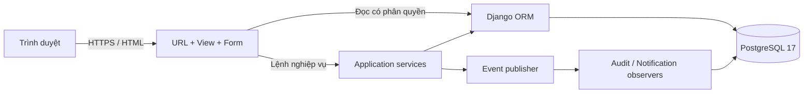
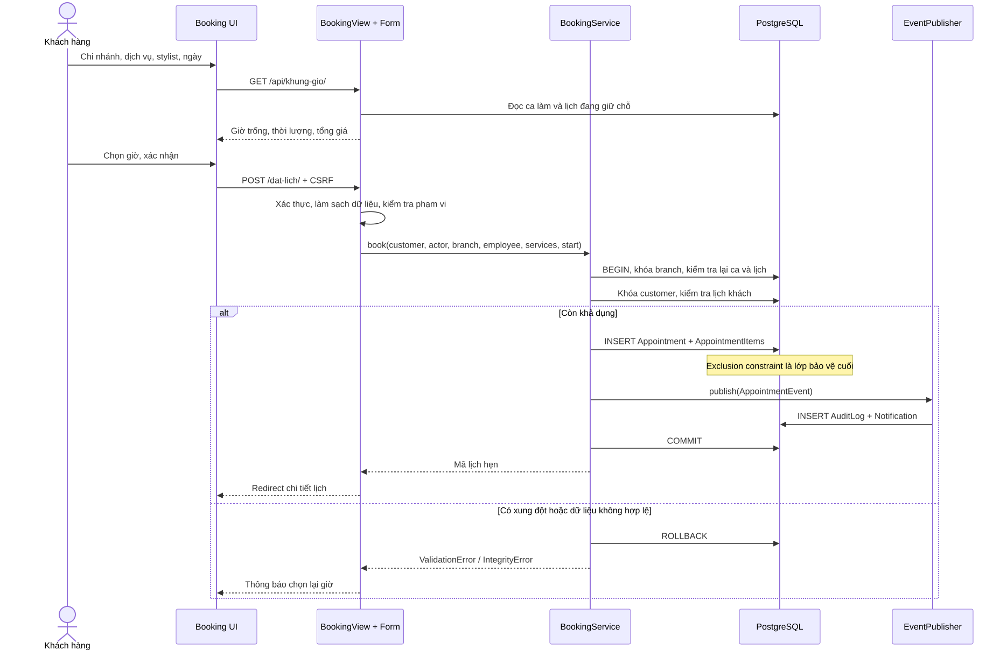

# Thiết kế hệ thống

## 1. Kiến trúc

Ứng dụng dùng kiến trúc Django đơn khối có phân lớp. Trình duyệt nhận HTML render phía server, CSS/JS local; khung giờ và báo giá thanh toán dùng fetch JSON. Quyết định này giữ việc cài đặt và triển khai đơn giản, không cần đồng bộ hai hệ xác thực frontend/backend.



- `models.py`: cấu trúc lưu trữ, ràng buộc và thuộc tính tính toán.
- `forms.py`: kiểm tra định dạng dữ liệu, lọc lựa chọn theo người dùng.
- `views.py`: xác thực, quyền trên đối tượng, truy vấn hiển thị, HTTP, CSV.
- `services.py`: lệnh đặt lịch/chuyển trạng thái có transaction, khóa và tái kiểm tra.
- `events.py`: Publisher thông báo các Observer trong cùng transaction; không cần Redis/Celery.
- `management_views.py`: cổng CRUD riêng, phân quyền manager, khóa khi thay đổi nguồn lực; `profile_views.py`: hồ sơ và đổi mật khẩu. Lịch và hóa đơn giữ luồng nghiệp vụ riêng.

## 2. Mô hình use case



Nguồn: thiết kế từ yêu cầu và mã triển khai. Đây là sơ đồ use case biểu diễn bằng Mermaid flowchart (không thay thế ký pháp UML đầy đủ). Mỗi quyền chi nhánh được thực thi ở server, không chỉ ẩn nút trong giao diện.

## 3. Mô hình dữ liệu quan hệ



PostgreSQL lưu Unicode bằng `varchar/text`, thời gian bằng `timestamptz`. Tất cả bảng nghiệp vụ có khóa chính `bigint`, đặt tên theo đối tượng: `manguoidung`, `machinhanh`, `malichhen`… Các trường bắt buộc không nhận NULL trừ khi ghi rõ. Tên bảng thực tế có tiền tố `salon_`. Các cột trong 25 bảng nghiệp vụ dùng tiếng Việt viết liền không dấu qua `db_column`, ví dụ `hoten`, `sodienthoai`, `thoigianbatdau`. Django còn quản lý các bảng auth, group, permission và session theo quy ước framework. Xem `05-TEN-COT-DU-LIEU.md` để đối chiếu đầy đủ các cột với tên thuộc tính Python; kiểu dữ liệu không thay đổi.

### 3.1 Từ điển dữ liệu

| Bảng | Các trường chính | Ràng buộc và ý nghĩa |
|---|---|---|
| User | manguoidung bigint, tendangnhap varchar(150), matkhau varchar(128), hoten varchar(100), sodienthoai varchar(10), thudientu varchar(254), vaitro varchar(20), machinhanh bigint nullable, diemtichluy integer, hoatdong boolean, lanhanvien boolean, laquantri boolean, ngaythamgia timestamptz, landangnhapcuoi timestamptz nullable, ten varchar(150), ho varchar(150) | tendangnhap unique; sodienthoai 10 số; vaitro customer/receptionist/manager; matkhau lưu hash; điểm không âm |
| Branch | machinhanh bigint, tenchinhanh varchar(100), diachi varchar(250), sodienthoai varchar(10), giomocua time, giodongcua time, hoatdong boolean | Tên unique; đóng sau mở; không hỗ trợ mở qua nửa đêm |
| Service | madichvu bigint, tendichvu varchar(100), mota text, loaidichvu varchar(10), giatien integer, thoiluong integer, hoatdong boolean | Giá >=1.000 VNĐ; thời lượng 15–240 phút; loại hair/care/combo; tên unique |
| Employee | manhanvien bigint, hoten varchar(100), machinhanh bigint, chuyenmon varchar(150), gioithieu varchar(250), hoatdong boolean | Stylist thuộc một chi nhánh; không đổi chi nhánh lịch sử qua cổng quản trị riêng |
| Chair | maghe bigint, machinhanh bigint, tenghe varchar(30), hoatdong boolean | Unique (machinhanh, tenghe) |
| Shift | macalam bigint, manhanvien bigint, thoigianbatdau timestamptz, thoigianketthuc timestamptz | Kết thúc sau bắt đầu; exclusion nhân viên + khoảng thời gian; trong giờ mở cửa |
| Appointment | malichhen bigint, makhachhang bigint, machinhanh bigint, manhanvien bigint, maghe bigint nullable, thoigianbatdau timestamptz, thoigianketthuc timestamptz, trangthai varchar(20), ghichu varchar(500), ngaytao timestamptz | Kết thúc sau bắt đầu; exclusion stylist/ghế trên lịch đang giữ; phân ghế khi check-in |
| AppointmentItem | machitiet bigint, malichhen bigint, madichvu bigint, tendichvu varchar(100), giatien integer, thoiluong integer | Unique (malichhen, madichvu); snapshot tên/giá/thời lượng |
| Invoice | mahoadon bigint, malichhen bigint unique, tongthanhtoan integer, tiengiam integer, diemdadung integer, phuongthucthanhtoan varchar(10), thoigianthanhtoan timestamptz, mathungan bigint | 0 hoặc 1 hóa đơn/lịch; bản ghi là giao dịch đã nhận tiền |
| Review | madanhgia bigint, malichhen bigint unique, sosao smallint, binhluan varchar(500), ngaytao timestamptz | 1–5 sao ở validator và DB; chỉ chủ lịch đã hoàn thành |
| Notification | mathongbao bigint, manguoinhan bigint, malichhen bigint nullable, ngaydoc timestamptz nullable, noidung varchar(250), ngaytao timestamptz | Thông báo nội bộ, không gửi email/SMS |
| AuditLog | manhatky bigint, manguoithaotac bigint nullable, malichhen bigint nullable, hanhdong varchar(100), ngaytao timestamptz | Nhật ký actor thực tế; FK SET NULL khi đối tượng bị xóa hợp lệ |

Các FK liên quan lịch sử tài chính dùng `PROTECT` để không xóa mất khách, chi nhánh, stylist, dịch vụ và hóa đơn. Dòng dịch vụ dùng CASCADE từ lịch hẹn, nhưng lịch có hóa đơn bị PROTECT. Notification có thể CASCADE khi xóa tài khoản. Trong giao diện vận hành, dữ liệu cũ được ngừng hoạt động thay vì xóa.

### 3.2 Chuẩn hóa và bản chụp lịch sử

Chi nhánh, stylist, ca làm, dịch vụ và khách tách riêng để tránh lặp dữ liệu chủ. Quan hệ lịch–dịch vụ là nhiều–nhiều qua AppointmentItem. Invoice/Review là một–không hoặc một với lịch hẹn. Dữ liệu tên, giá và thời lượng được lặp có chủ ý trong AppointmentItem để ghi nhận thỏa thuận lúc đặt; đây là snapshot nghiệp vụ, không phải tham chiếu đến giá hiện hành.

Tổng hóa đơn bằng tổng cột `giatien` của các dòng dịch vụ. Điểm bằng `tongthanhtoan // 10000` (trong Python tương ứng `AppointmentItem.price` và `invoice.total`). Không dùng số dấu phẩy động cho VNĐ; không nhận giá hoặc tổng tiền từ client. Mã hiển thị LH00001/HD00001 được suy ra từ PK, không tạo bộ đếm thủ công.

### 3.3 Chỉ mục và ràng buộc lịch

Migration tạo extension `btree_gist` và các exclusion constraints:

```sql
EXCLUDE USING gist (
  manhanvien WITH =,
  tstzrange(thoigianbatdau, thoigianketthuc) WITH &&
) WHERE (trangthai IN ('booked', 'checked_in', 'in_service'));
```

Ghế áp dụng tương tự với `maghe IS NOT NULL`; ca làm dùng employee + range không có điều kiện trạng thái. Range mặc định `[)` cho phép sát giờ. Index B-tree `(machinhanh, thoigianbatdau)` và `(makhachhang, thoigianbatdau)` hỗ trợ các truy vấn lịch theo phạm vi; FK có index tự động. Điều kiện `.date()` hiện ưu tiên rõ ràng cho đồ án; khi dữ liệu lớn nên đổi sang khoảng UTC và đo bằng EXPLAIN.

### 3.4 Giao dịch và truy cập đồng thời

Mọi lệnh tạo/chuyển trạng thái khóa Branch trước. Lệnh đặt tiếp tục khóa Customer, kiểm tra lại lịch khách sau khi lấy khóa. Việc tuần tự hóa theo chi nhánh đơn giản hóa điều phối ghế/stylist; nhược điểm là giới hạn throughput tại chi nhánh rất bận. GiST là lớp chống trùng cuối cùng khi ứng dụng bỏ sót kiểm tra. Thanh toán khóa lịch và có FK unique hóa đơn, vì vậy yêu cầu lặp không tạo thêm tiền hoặc điểm.

Các chỉnh sửa danh mục qua cổng quản trị riêng dành cho quản trị viên. Ràng buộc snapshot giữ nguyên lịch cũ. Việc cập nhật ca làm đồng thời với một lệnh đặt cần khóa cùng chi nhánh trong bước lưu có transaction của cổng quản trị riêng; form vẫn kiểm tra lại các lịch đã có. Không hỗ trợ sửa lịch trực tiếp bằng SQL như một luồng vận hành.

## 4. Mô hình trạng thái và hoạt động



| Trạng thái hiện tại | Lệnh | Trạng thái tiếp theo | Điều kiện |
|---|---|---|---|
| booked | checkin | checked_in | Đúng ngày, ghế thuộc chi nhánh, không bận |
| checked_in | start | in_service | Stylist không đang phục vụ khách khác |
| in_service | finish | awaiting_payment | Ghi giờ phục vụ xong và giải phóng ghế/stylist |
| awaiting_payment | pay | completed | Phương thức/điểm/voucher/báo giá hợp lệ; ngày chưa chốt |
| checked_in | release_checkin | booked | Operator có lý do, trả lịch về điều phối và giải phóng ghế |
| booked | cancel | cancelled | Chủ lịch còn đủ giờ theo chính sách chi nhánh hoặc operator đúng phạm vi |
| booked | no_show | no_show | Operator đúng phạm vi, qua start_at + thời gian chờ muộn |

`completed/cancelled/no_show` là trạng thái kết thúc. Hoàn tiền toàn bộ ghi chứng từ `Refund` riêng; không đảo trạng thái completed hoặc sửa hóa đơn gốc. Quy tắc điểm/hoa hồng/sổ khóa tại tài liệu 13.

## 5. Tương tác đặt lịch



API khả dụng không giữ chỗ. Form xác nhận mới tạo transaction. Nếu hai trình duyệt cùng nhìn thấy 10:00, chỉ một transaction có thể ghi lịch đang giữ cho cùng stylist; trình duyệt còn lại nhận yêu cầu chọn giờ khác.

## 6. Lớp nghiệp vụ và mẫu thiết kế





- **Factory:** PaymentFactory tạo CashPayment hoặc MockPayment theo method đã kiểm tra.
- **Strategy:** hai payment strategy triển khai cùng giao thức `method`, `validate(confirmation)`, được chọn khi checkout. Không có logic ngân hàng thật.
- **Observer:** AppointmentPublisher giữ các subscriber AuditObserver/NotificationObserver; mỗi sự kiện gọi `update(event)`. Việc ghi hai đầu ra cùng transaction bảo đảm không gửi thông báo thành công cho lịch rollback. Khi thêm email/SMS cần dùng transactional outbox và worker sau commit; không gọi dịch vụ ngoài trong transaction hiện tại.

Các thuộc tính lưu trữ trong sơ đồ lớp được trình bày theo tên cột SQL tiếng Việt; code, total, is_operator và initials là thuộc tính tính toán, không phải cột SQL. Mã Python giữ API ổn định thông qua ánh xạ db_column. Sơ đồ dùng interface theo duck typing; `BookingService` là tên nhóm trách nhiệm của các hàm trong `services.py`, không khai báo thêm lớp rỗng chỉ để khớp hình vẽ. Các lớp dữ liệu miền và quan hệ nằm trong ERD cùng các Django model tương ứng.

## 7. Giao diện và điều hướng



| Màn hình | Thành phần và hành vi |
|---|---|
| Trang chủ | Hero ảnh chụp local, chọn chi nhánh nhanh, dịch vụ có bộ lọc, bộ sưu tập cuộn ngang, stylist, CTA đặt lịch |
| Đặt lịch | 3 phần: chi nhánh, dịch vụ, stylist/thời gian; khung giờ tải JSON; tóm tắt giá; chống response cũ ghi đè khi đổi lựa chọn nhanh |
| Lịch cá nhân | Lịch có tìm kiếm/phân trang; liên kết thông báo đọc/chưa đọc và lịch sử điểm |
| Chi tiết | Mã, thời gian, chi nhánh, stylist, ghế, snapshot dịch vụ, thao tác theo role/state |
| Tổng quan | Chọn ngày/chi nhánh; doanh thu, số lịch, hoàn thành, stylist; chart 7 ngày và bảng lọc/phân trang |
| Ca làm | Danh sách stylist, ca và lịch khách trong ngày; dẫn vào chi tiết để vận hành |
| Báo cáo | Khoảng ngày, chi nhánh, tổng/đếm/trung bình, bảng hóa đơn, Excel/PDF/CSV |
| Thiết lập riêng | Thêm/sửa/xóa tài khoản, dịch vụ, chi nhánh, stylist, ghế và ca làm; bảo vệ lịch sử |
| Trang cá nhân | Sửa thông tin liên hệ, đổi mật khẩu có xác nhận mật khẩu hiện tại |

Giao diện khách hàng dùng nền kem `#f8f7f4`, chữ than `#222321`, cam đất `#bd4c2f`, font Be Vietnam Pro và ảnh chụp WebP local. Không gian vận hành giữ xanh đậm `#24332b` và cam đất `#bd6946`. Không phụ thuộc font hoặc ảnh từ CDN. Chuyển động hỗ trợ reduced motion; menu mobile và bộ lọc có trạng thái truy cập. Chi tiết bản thiết kế mới tại [Giao diện khách hàng](06-GIAO-DIEN-KHACH-HANG.md). Dùng label/fieldset phù hợp, focus bàn phím, aria-live cho khung giờ, xác nhận thao tác quan trọng và chế độ in phiếu. Bảng rộng cuộn trong vùng riêng, không làm tràn cả trang trên mobile.

## 8. Thiết kế HTTP và quyền

| Method / URL | Dữ liệu / hành vi | Quyền |
|---|---|---|
| GET / | Danh mục công khai | Mọi người |
| GET/POST /dang-ky/ | Đăng ký, tự gán customer | Chưa đăng nhập |
| GET/POST /dang-nhap/ | Session login, kiểm tra next URL cùng host | Mọi người |
| POST /dang-xuat/ | Hủy session | Đăng nhập |
| GET /api/khung-gio/ | branch, employee, date, services[] | Công khai; không trả dữ liệu khách |
| GET/POST /dat-lich/ | BookingForm; server tự tính giá | Đăng nhập; đặt hộ yêu cầu operator |
| GET /lich-cua-toi/ | Lịch theo customer=request.user | Chủ tài khoản |
| GET /lich-hen/{id}/ | Chi tiết | Chủ lịch hoặc operator đúng phạm vi |
| POST /lich-hen/{id}/thao-tac/ | action, chair, method, confirmation | Theo trạng thái và actor |
| POST /lich-hen/{id}/danh-gia/ | rating, comment | Chủ lịch completed |
| GET /lich-hen/{id}/hoa-don/ | Phiếu đã thanh toán | Cùng quyền chi tiết |
| GET /quan-ly/* | Dashboard, khách, danh mục, ca, chi nhánh, báo cáo | Operator, có lọc scope |
| GET /health/ | SELECT 1; HTTP 200/503 | Không chứa bí mật |

Lỗi nhập liệu render lại form có thông báo; quyền sai 403 hoặc đối tượng ngoài scope 404; API tham số sai 400. Các thay đổi trạng thái chỉ POST và kiểm tra CSRF. Export Excel/PDF/CSV áp dụng cùng scope với báo cáo HTML.

## 9. Quản trị riêng và hồ sơ

Màn hình `/quan-ly/thiet-lap/` thay giao diện quản trị mặc định. `manager_required` kiểm tra vai trò ở mỗi request; profile chỉ cập nhật người đang đăng nhập. CRUD thay đổi trong transaction, khóa chi nhánh theo thứ tự và ghi audit. GET không xóa; POST yêu cầu CSRF và xác nhận. Chi tiết tại [Quản trị riêng](07-QUAN-TRI-RIENG.md).


## 10. Hoàn thiện vận hành

`operations.py` cung cấp trang thông báo, nhật ký, lịch tuần và hiệu quả; PasswordResetView/ConfirmView dùng token Django với timeout 1 giờ, local email trong DEBUG hoặc SMTP cấu hình. Notification thêm `malichhen` nullable và `ngaydoc`; chỉ người nhận được đánh dấu đọc qua POST.

Invoice thêm `tiengiam`, `diemdadung`; `subtotal = total + discount`. Database ràng buộc discount = points_used × 1.000 và discount ≤ subtotal/5. `PointEntry` là bảng thứ 13, ghi customer/invoice/kind/amount/balance/created_at; unique invoice+kind và một opening mỗi khách, số điểm redeemed âm và earned/opening không âm. Migration ghi số dư chuyển tiếp, không cộng lại tiền/điểm cũ. Thanh toán khóa Branch → Appointment → User; cập nhật hóa đơn/số dư/ledger cùng transaction.

Doanh thu theo ngày paid_at, số lịch/tỷ lệ hủy theo ngày start_at. So sánh kỳ trước có cùng độ dài. Doanh thu dịch vụ phân bổ thực thu theo tỷ trọng các dòng snapshot, phần dư làm tròn thuộc dòng cuối. Mọi query operator giữ scope chi nhánh.

Backup dùng pg_dump custom từ exported snapshot repeatable-read cùng số dòng metadata; restore kiểm SHA256, chỉ tạo database mới, single transaction và so số dòng. Không phục hồi qua HTTP hoặc tự đổi cấu hình database đang dùng.

Chi tiết đường dẫn, cấu hình và quy tắc: [Hoàn thiện chức năng](11-HOAN-THIEN-CHUC-NANG.md).

## 17. Thiết kế vận hành nhiều chi nhánh

`business.py` là lớp giao dịch cho tiếp nhận, dịch vụ phát sinh, nghỉ, thu/hoàn tiền, chốt sổ và kho; `business_views.py`/`business_forms.py` lọc dữ liệu theo quyền. `scheduling.py` dùng sweep-line cho sức chứa và đọc theo lô để tính giờ trống. `activation.py` dùng token email để kích hoạt hồ sơ chưa có mật khẩu, chỉ dành cho customer.

Bổ sung EmployeeAbsence, BranchClosure, AppointmentChange, EmailOutbox, Voucher/VoucherUse, Product/Stock/StockMovement, Commission, Refund và DailyClosing. Invoice lưu giảm voucher, điểm thực cộng và điểm bù nợ; User lưu điểm cần thu hồi riêng. Từ điển dữ liệu được sinh từ toàn bộ 25 model.

Chuỗi khóa: Branch trước Appointment/Invoice/Customer/Voucher; chuyển kho khóa hai Branch theo ID tăng dần. Mỗi hóa đơn một lần dùng voucher, một commission và tối đa một refund; chốt sổ unique branch/day. Sự kiện ghi outbox trong cùng transaction, gửi SMTP bằng worker độc lập có khóa `skip_locked` và retry. Không có exactly-once giữa SMTP và PostgreSQL.





Các use case, phạm vi quyền, công thức thu ròng/hoa hồng và chính sách cụ thể tại [tài liệu 13](13-NGHIEP-VU-NHIEU-CHI-NHANH.md). ER cũ mô tả các bảng lõi; ER mở rộng ở đây bổ sung các quan hệ mới. Các trường SQL đầy đủ ở từ điển dữ liệu.
