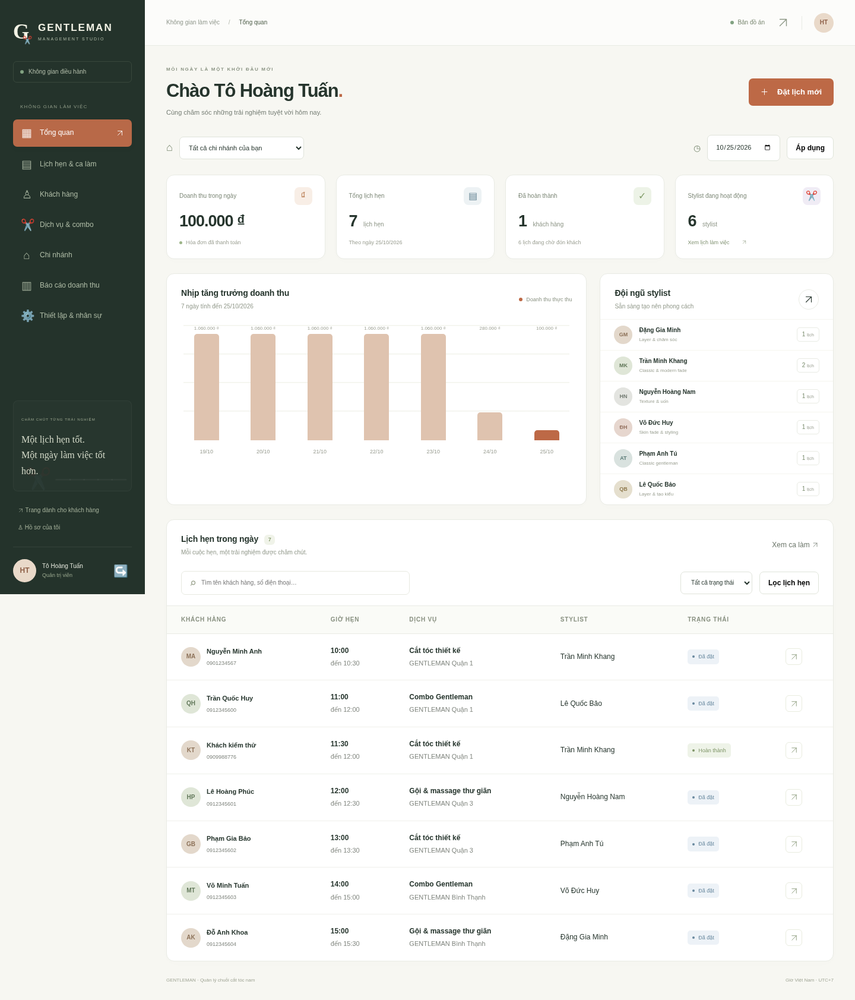
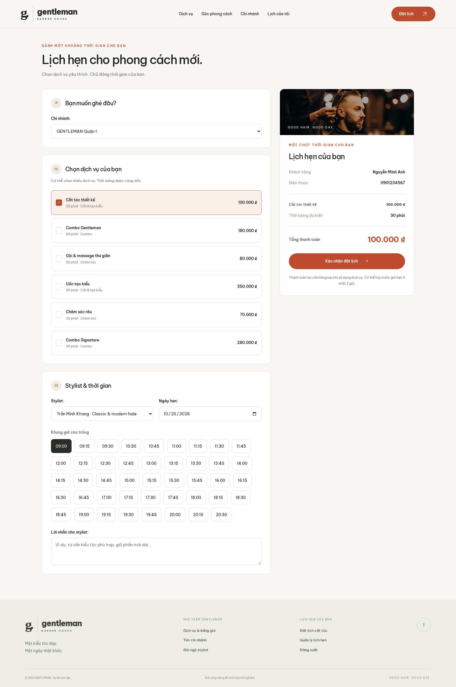
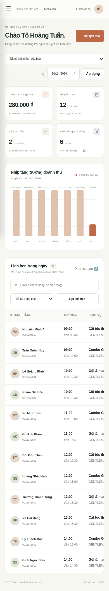

# Kiểm thử và kết quả build

## 1. Môi trường thực thi

Python 3.12.14, Django 5.2.18, psycopg 3.3.6, PostgreSQL 17 (image postgres:17-alpine), Gunicorn 26.2.0. Kiểm thử nghiệp vụ dùng PostgreSQL thực, không thay bằng SQLite hoặc mock database. Browser smoke dùng Playwright 1.62.0 và Chromium headless cài riêng.

## 2. Kết quả thực tế

| Kiểm tra | Kết quả | Bằng chứng / phạm vi |
|---|---|---|
| `bash scripts/setup.sh` chạy lại | Đạt | Không có migration mới; vẫn 3 chi nhánh, 6 stylist, 6 dịch vụ, 102 lịch mẫu; không nhân đôi dữ liệu |
| `manage.py check` | Đạt | 0 vấn đề |
| `makemigrations --check --dry-run` | Đạt | No changes detected |
| `manage.py test salon.tests --noinput` | Đạt | 35 test đã thực thi, 0 failed, 0 errors, 0 skipped |
| Migration tên cột tiếng Việt | Đạt | 80 cột/12 bảng; kiểu dữ liệu và toàn bộ bản ghi giữ nguyên; kiểm tra cả nâng cấp và hoàn tác |
| `collectstatic --noinput` | Đạt | Static và manifest tạo thành công; chạy lại giữ nguyên tài nguyên không đổi |
| `scripts/start.sh` | Đạt | Bật DB, kiểm tra migration, khởi động Django; health và trang chủ phản hồi thành công |
| Docker image | Đạt | Build bằng wheelhouse trên cloud; artifact tải qua HTTPS, pip không tắt TLS |
| Gunicorn + WhiteNoise + PostgreSQL | Đạt | Container web chạy 2 workers, /health/ trả database postgresql, trang và static phục vụ được |
| Browser smoke local | Đạt | Đi hết đăng ký/đặt/hủy/check-in/phục vụ/thanh toán mô phỏng/hóa đơn/đánh giá/CSV |
| Browser smoke qua web container | Đạt | Cùng luồng nghiệp vụ qua Gunicorn/WhiteNoise |
| Responsive | Đạt | Giao diện khách hàng 320/360/390/768/1024/1440 px; không tràn ngang; menu mobile/Escape hoạt động |
| Customer UI smoke | Đạt | Bộ lọc, bộ sưu tập, preselect dịch vụ/stylist/chi nhánh, đăng nhập giữ lựa chọn, reduced motion, không JavaScript, ảnh/font local |
| JavaScript | Đạt | Không có pageerror trong luồng browser smoke |
| `check --deploy --fail-level WARNING` | Đạt với cấu hình production thử nghiệm | DEBUG=0 và secret ngẫu nhiên tạm thời; không phải bằng chứng đã bật HTTPS hoặc public deployment |
| GitHub Actions | Chưa xác minh kết quả trên GitHub | Đã có workflow test/build; xem tab Actions của repository để theo dõi |
| Thanh toán thật, SMS/email, tải lớn, restore backup | Chưa thực hiện | Ngoài phạm vi bản dựng |

Các kiểm thử ban đầu phát hiện lỗi tên alias aggregate khi tính trung bình và thiếu savepoint khi bắt đánh giá trùng. Mã đã sửa và bộ test chạy lại thành công. Sau khi đổi tên 80 cột sang tiếng Việt không dấu, 35 kiểm thử và browser smoke đã chạy lại thành công; dữ liệu và kiểu dữ liệu PostgreSQL được đối chiếu trước/sau migration. Build Docker online ban đầu gặp DNS trong container; giải pháp dùng wheel tải trên host và cài offline đã build thành công. Đây là chẩn đoán và xử lý lỗi môi trường, không phải thay đổi phiên bản để né test.

Sau thiết kế lại giao diện, script check thu thập static trước khi chạy Django tests để manifest luôn chứa CSS, ảnh và font mới. Workflow GitHub tạo virtualenv trước khi gọi script này. Bộ UI smoke mới kiểm tra độc lập tương tác khách hàng; kết quả chi tiết ở `docs/validation/customer-redesign.txt`.

## 3. Các nhóm kiểm thử nghiệp vụ

| Nhóm | Trường hợp tiêu biểu | Yêu cầu liên quan |
|---|---|---|
| Đặt lịch | Nhiều dịch vụ, tổng thời lượng, snapshot không đổi sau sửa giá | FR03, FR04 |
| Khả dụng | Ca làm, giờ mở/đóng, thời gian quá khứ, 30 ngày, bước 15 phút | FR02, FR03 |
| Xung đột | Stylist trùng, hai lịch sát giờ, khách trùng ở chi nhánh khác, bypass service bị DB chặn | FR04 |
| Migration cột | So sánh dữ liệu và kiểu PostgreSQL trước/sau, hoàn tác rồi nâng cấp lại, giữ FK và nhóm quyền đăng nhập | Toàn vẹn schema |
| Đồng thời | Hai thread với hai connection cùng đặt một stylist/giờ, chỉ một lịch được ghi | FR04 |
| Hủy/no-show | Hủy giải phóng chỗ; hạn 2 giờ; no-show chỉ sau giờ kết thúc | FR05 |
| Lễ tân | Đặt hộ đúng khách, actor đúng; khách ngoài phạm vi bị từ chối | FR01, FR12 |
| Đón khách | Check-in đúng ngày; từ chối ghế khác chi nhánh hoặc ghế bận | FR06 |
| Checkout | Không nhảy trạng thái; một hóa đơn/một lần điểm; mock phải xác nhận | FR07 |
| Ca làm | Không sửa ca làm mất phạm vi phục vụ lịch đã đặt | FR09 |
| HTTP/Auth | Trang yêu cầu login; khách không vào quản lý; chủ khác nhận 404; CSRF; POST-only; chống open redirect | FR01 |
| Báo cáo | Render thống kê, CSV chống công thức, hóa đơn chỉ đúng người xem | FR10 |
| Đánh giá | Chỉ sau completed; số sao hợp lệ; không đánh giá hai lần | FR08 |
| Sự kiện | Đặt lịch có audit/notification; đặt hộ lưu actor thực | FR11 |

## 4. Kiểm tra thủ công có thể lặp lại

1. Đăng nhập khách, chọn stylist không có ca tại ngày sau phạm vi được cấp; không có giờ để đặt.
2. Chọn hai dịch vụ rồi đổi sang một dịch vụ; danh sách giờ và tổng được cập nhật, giờ chọn cũ bị bỏ.
3. Gửi cùng một form đặt hai lần; yêu cầu sau không tạo lịch trùng.
4. Lễ tân đăng nhập Quận 1 và thay ID URL sang lịch Quận 3; không xem được đối tượng.
5. Thanh toán mô phỏng không tick xác nhận; không có hóa đơn và điểm mới.
6. Thanh toán xong rồi tải lại/gửi lại; không có hóa đơn thứ hai.
7. Chọn ngày báo cáo không có giao dịch; tổng 0, không hiển thị tăng trưởng giả.

Không xem PID hoặc port mở là tiêu chí đủ; browser smoke kiểm tra hành vi đến tận hóa đơn và đánh giá. Script browser dọn đúng dữ liệu của tài khoản smoke vừa tạo; bộ Django test dùng database riêng.

## 5. Hình minh họa

Ảnh chụp từ bản chạy với dữ liệu mẫu. Số liệu trong ảnh phản ánh thời điểm chụp, không phải doanh thu của một cửa hàng thực.

## 6. Kết luận nghiệm thu bản phát triển

Quy trình phát triển và trình diễn cốt lõi chạy được trên môi trường hiện tại, có Docker và hướng dẫn tái lập. Mã nguồn và tài liệu được lưu trong checkout và đã đẩy lên nhánh main của repository GitHub tunato2807-del/ptpmhdtuong theo yêu cầu người dùng. Ứng dụng chưa được triển khai thành dịch vụ công khai. Cấu hình môi trường cloud được lưu nháp để người dùng xem và publish; việc publish và phục hồi ở task mới là bước riêng, chưa được tuyên bố đã kiểm chứng.
