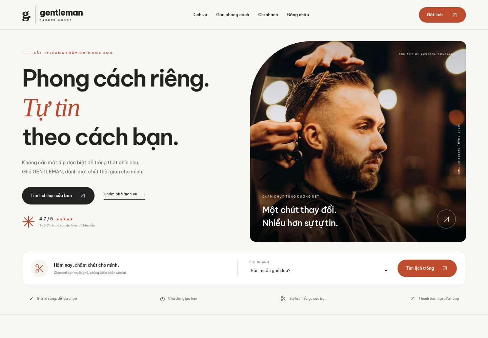
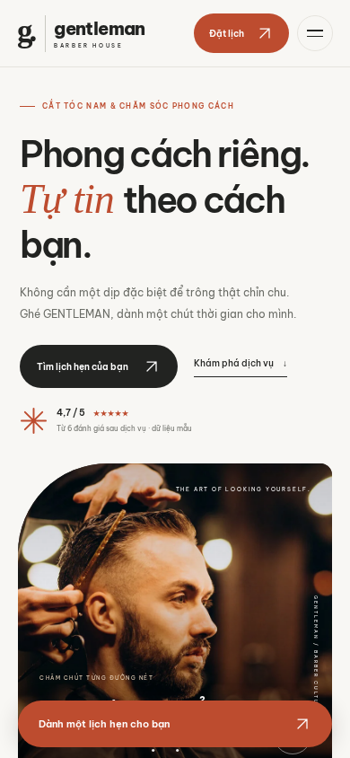

# Giao diện khách hàng

## 1. Định hướng

Yêu cầu: tham khảo Fresha và 30Shine, giao diện tự nhiên, dùng ảnh chụp thật và có chuyển động. Hai địa chỉ được người dùng cung cấp:

- https://www.fresha.com/lp/en/bt/hair-salons/in/vietnam
- https://30shine.com/

Môi trường cloud trả HTTP 403 tại proxy khi truy cập hai tên miền trong lần thực hiện này. Vì vậy bản thiết kế chưa được đối chiếu trực tiếp với phiên bản hiện tại của hai website. Không sao chép logo, nội dung đánh giá hoặc ảnh của hai thương hiệu. Hướng thiết kế sử dụng thẻ dịch vụ dễ khám phá, ảnh barber lớn, thanh chọn chi nhánh và đường dẫn đặt lịch rõ ràng.

## 2. Thiết kế đã triển khai

- Nhận diện GENTLEMAN: nền kem `#f8f7f4`, chữ than `#222321`, cam đất `#bd4c2f`, vùng bộ sưu tập xanh xám nhạt. Font Be Vietnam Pro lưu trong dự án, hỗ trợ đầy đủ dấu tiếng Việt.
- Trang chủ: hero ảnh thật, thanh đặt lịch nhanh theo chi nhánh, dịch vụ có bộ lọc, bộ sưu tập phong cách kéo ngang, thông tin chi nhánh, đội ngũ stylist, hướng dẫn ba bước và lời mời đặt lịch.
- Thẻ dịch vụ dùng tên, giá, thời lượng thực từ PostgreSQL. Nút chọn dịch vụ chuyển vào biểu mẫu với dịch vụ đã được chọn. Chọn stylist chuyển cả chi nhánh và stylist tương ứng. Khách chưa đăng nhập được chuyển qua đăng nhập, giữ URL đặt lịch.
- Ảnh stock là ảnh minh họa hoạt động barber; không nhận là ảnh thật của chi nhánh hoặc chân dung nhân viên trong dữ liệu mẫu. Tên stylist được trình bày với chữ viết tắt riêng. Chỉ số đánh giá lấy từ database; chế độ demo ghi rõ dữ liệu mẫu.
- Trang đặt lịch: ba phần rõ ràng, thẻ tóm tắt có ảnh, lựa chọn dịch vụ, khung giờ và tổng tiền cập nhật theo luồng hiện có. Không hiển thị CTA nổi che biểu mẫu trên trang này.
- Đăng nhập, đăng ký, lịch cá nhân, chi tiết và hóa đơn dùng chung nhận diện khách hàng. CSS mới được giới hạn trong `.customer-app`, giữ không gian vận hành riêng.

## 3. Chuyển động và khả năng sử dụng

- Ảnh hero xuất hiện nhẹ; các phần tiếp theo hiện dần khi cuộn bằng IntersectionObserver.
- Ảnh dịch vụ/phong cách phóng nhẹ khi hover; nút và thẻ có chuyển tiếp ngắn.
- Bộ sưu tập hỗ trợ nút trước/sau, kéo ngang tự nhiên, scroll snap và phím mũi tên khi vùng bộ sưu tập được focus. Không tự chạy liên tục.
- Menu mobile có aria-expanded, đóng bằng Escape hoặc khi chọn liên kết; Escape trả focus về nút menu.
- `prefers-reduced-motion: reduce` tắt chuyển động và hiển thị ngay các phần nội dung, kể cả khi đổi tùy chọn trong phiên.
- Không có JavaScript: menu và toàn bộ dịch vụ vẫn đọc được, liên kết vẫn hoạt động; bộ lọc và nút cuộn tăng cường được ẩn. Chọn giờ đặt lịch vẫn cần JavaScript như bản trước.
- Ảnh WebP, có kích thước khai báo, lazy loading dưới phần đầu; ảnh hero ưu tiên tải. Sáu ảnh tổng khoảng 300 KB. Font và ảnh được phục vụ từ static local, không cần CDN khi khách mở trang.

## 4. Mã nguồn và kiểm tra

| Thành phần | Vị trí |
|---|---|
| Bố cục/header/footer | templates/base.html |
| Trang chủ | templates/public/home.html |
| Trang đặt lịch | templates/public/booking.html |
| Giao diện | static/css/customer.css |
| Tương tác | static/js/customer.js |
| Ảnh chụp | static/images/photos/ |
| Font | static/fonts/ |
| Nguồn tài nguyên | docs/NGUON-TAI-NGUYEN.md |
| Kiểm thử giao diện | scripts/customer_ui_smoke.py |

Chạy ứng dụng với dữ liệu demo rồi thực thi:

```bash
BROWSER_EXECUTABLE=/tmp/chromium .venv/bin/python scripts/customer_ui_smoke.py
BROWSER_EXECUTABLE=/tmp/chromium .venv/bin/python scripts/browser_smoke.py
bash scripts/check.sh
```

Đường dẫn Chromium ở trên dành cho môi trường cloud hiện tại. Máy cá nhân có thể bỏ biến BROWSER_EXECUTABLE sau khi cài Chromium theo README. Kiểm thử giao diện kiểm tra bộ lọc, cuộn bộ sưu tập, menu, dữ liệu chọn sẵn sau đăng nhập, khung giờ, ảnh/font local, reduced motion, không JavaScript và bố cục từ 320 đến 1440 px. Script giao diện chỉ đọc dữ liệu và đăng nhập tài khoản demo, không tạo lịch hẹn. Script workflow tạo và xóa đúng dữ liệu kiểm thử của nó.





Bản chụp toàn trang ở `docs/screenshots/home-desktop.png` và `docs/screenshots/home-mobile.png`; biểu mẫu mobile ở `docs/screenshots/booking-mobile.png`.
