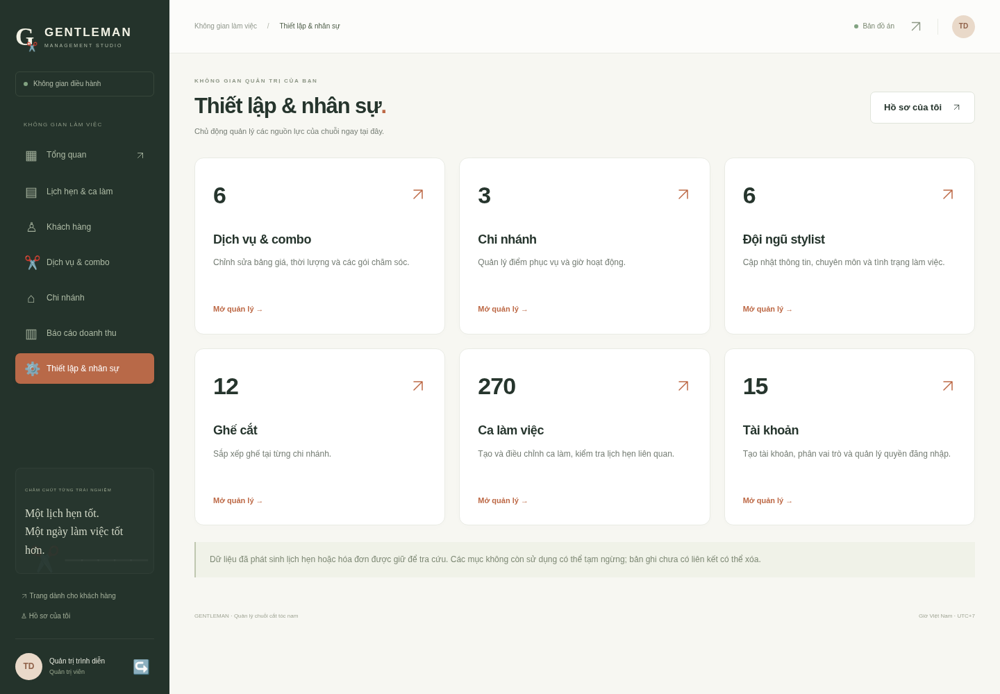
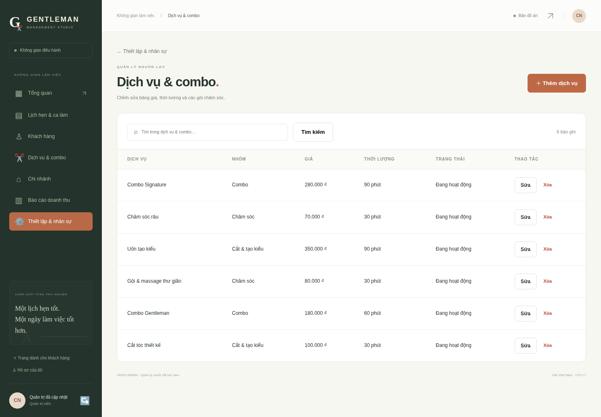
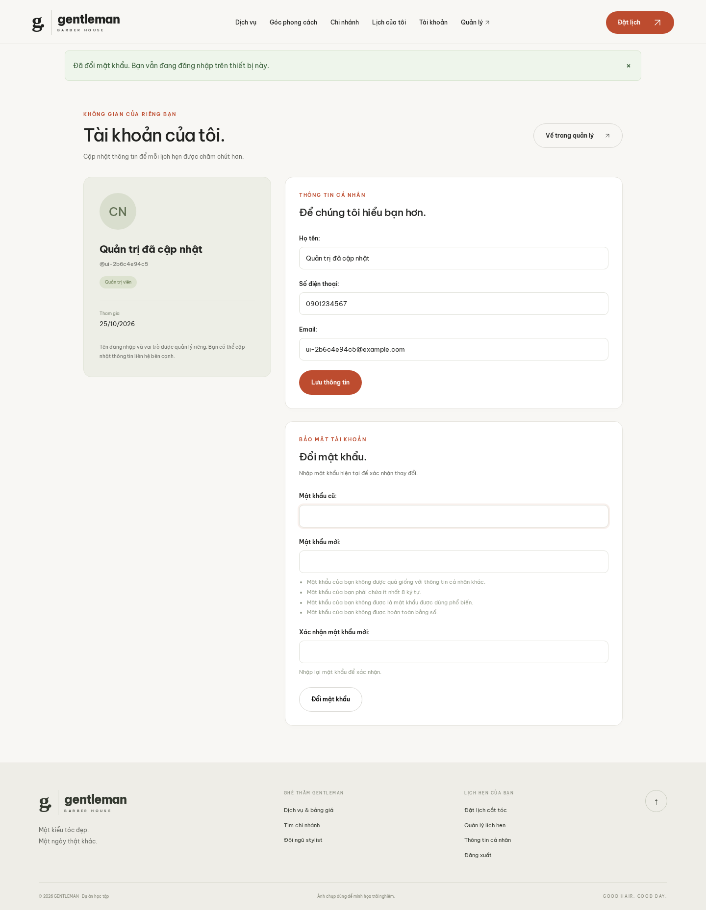

# Cổng quản trị riêng và trang cá nhân

## 1. Phạm vi

Toàn bộ thao tác danh mục và nhân sự dùng template/view/form của GENTLEMAN, cùng nhận diện với cổng vận hành. Ứng dụng quản trị có sẵn của Django đã được gỡ khỏi INSTALLED_APPS và URL; `/admin/` trả 404. File salon/admin.py được loại bỏ. Django auth/session/CSRF vẫn được dùng để xác thực và bảo vệ dữ liệu.

Các file cấu hình container, wheelhouse build và script build liên quan đã được loại khỏi dự án. Dependencies không còn Gunicorn; các script setup/start/check chỉ dùng Python và kết nối PostgreSQL có sẵn. Có hướng dẫn Windows/VS Code, không yêu cầu launcher py hoặc kích hoạt môi trường ảo bằng PowerShell.

## 2. Các màn hình mới

| Đường dẫn | Mục đích |
|---|---|
| `/tai-khoan/` | Hồ sơ và đổi mật khẩu cho mọi người đăng nhập |
| `/quan-ly/thiet-lap/` | Sáu nhóm tài nguyên, số bản ghi và liên kết quản lý |
| `/quan-ly/thiet-lap/{nhom}/` | Tìm kiếm, phân trang, sửa/xóa từng bản ghi |
| `/quan-ly/thiet-lap/{nhom}/them/` | Tạo mới |
| `/quan-ly/thiet-lap/{nhom}/{id}/sua/` | Chỉnh sửa |
| `/quan-ly/thiet-lap/{nhom}/{id}/xoa/` | Xác nhận và thực hiện xóa bằng POST |

Nhóm: dich-vu, chi-nhanh, stylist, ghe, ca-lam, tai-khoan. Các nút trên trang vận hành dẫn thẳng vào nhóm liên quan. Màn hình có lỗi nhập liệu theo trường, thông báo kết quả, đường quay lại và xác nhận xóa.

## 3. Quyền và kiểm tra dữ liệu

- Chỉ vai trò manager truy cập CRUD; cờ staff/superuser không cấp quyền qua cổng này. Lễ tân và khách bị trả 403 ở server khi cố mở hoặc gửi POST tới URL quản trị.
- Trang cá nhân lấy người dùng từ phiên đăng nhập. Form chỉ nhận họ tên, điện thoại, email. Các giá trị gửi thêm như role, points, password hoặc ID người khác không được lưu.
- Đổi mật khẩu dùng PasswordChangeForm, xác nhận mật khẩu hiện tại, kiểm tra chất lượng và lưu hash; cập nhật session auth hash cho thiết bị hiện tại.
- Tạo tài khoản yêu cầu mật khẩu; sửa có thể giữ mật khẩu cũ bằng cách để trống. Không hiển thị mật khẩu/hash, điểm hoặc quyền kỹ thuật trong form. Tự đổi mật khẩu qua trang cá nhân.
- Không khóa, hạ quyền hoặc xóa chính tài khoản quản trị đang đăng nhập; hệ thống giữ ít nhất một manager hoạt động. Lễ tân cần chi nhánh phụ trách đang hoạt động. Khách đã có lịch hẹn giữ vai trò khách để bảo toàn lịch sử.
- Stylist/ghế giữ chi nhánh khi sửa. Ca làm phải trong một ngày, trong giờ mở cửa, không trùng và không bỏ rơi lịch đã đặt. Ngừng stylist/ghế/chi nhánh bị chặn khi còn lịch đang cần phục vụ.
- Xóa cần tick xác nhận và POST/CSRF. FK PROTECT giữ lịch sử. Không xóa ca đang bao phủ lịch hoạt động. GET chỉ hiển thị bước xác nhận.
- Giao dịch quản lý dùng advisory lock và khóa chi nhánh cùng thứ tự với booking/checkout, sau đó mới khóa tài khoản; tránh chỉnh ca làm đồng thời với việc đặt lịch gây mất phạm vi phục vụ. Có AuditLog cho tạo/sửa/xóa, cập nhật hồ sơ và đổi mật khẩu, không ghi nội dung mật khẩu.

## 4. Dữ liệu và nâng cấp

Giữ 12 bảng nghiệp vụ, 80 tên cột tiếng Việt và các kiểu PostgreSQL hiện có. Không có migration schema mới. Tên Python vẫn ánh xạ bằng db_column. Các bảng kỹ thuật cũ nếu đã tồn tại không bị drop hoặc xóa dữ liệu khi gỡ trang quản trị có sẵn.

Khi nâng cấp chỉ cài requirements mới, migrate, collectstatic và khởi động web. Giữ .env/database, không chạy lại seed chỉ để cập nhật tính năng.

## 5. Kiểm chứng

53 tests PostgreSQL: 35 test trước và 18 test mới cho quyền CRUD, tạo/sửa/xóa sáu nhóm, xóa có xác nhận, chống sửa trường ẩn, CSRF, snapshot, ca làm, giờ mở cửa, tài khoản cá nhân và mật khẩu. Browser smoke quản trị đi qua sáu nhóm bằng thao tác thực, kiểm tra bố cục 320–1440 px, đổi mật khẩu và đăng nhập lại; tự dọn dữ liệu của mình.

Ảnh mobile riêng ở screenshots/management-mobile.png và screenshots/profile-mobile.png. Dữ liệu trong ảnh là dữ liệu trình diễn.
