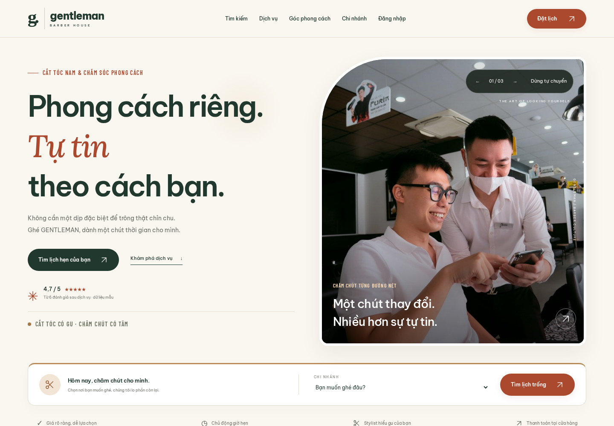

# Phối phông tiếng Việt và giao diện salon Việt Nam

Bản cập nhật ngày 26/10/2026 bổ sung Lora + Barlow Condensed bên cạnh Be Vietnam Pro; trang chủ dùng tông kem, xanh rêu, đồng ấm, khung ảnh bo góc, thẻ dịch vụ và chân trang mới. Các phông trang trí chỉ áp dụng vào các thành phần được chọn. Biểu mẫu, dữ liệu và menu quản lý vẫn ưu tiên phông dễ đọc.

Ảnh trên trang chủ, đăng nhập, đặt lịch, thẻ dịch vụ và các slide được thay bằng ảnh tham khảo salon Việt Nam. Nguồn, kích thước và tình trạng giấy phép ghi trong [NGUON-TAI-NGUYEN.md](NGUON-TAI-NGUYEN.md). Không giả định các người mẫu hoặc cửa hàng trong ảnh thuộc Gentleman.

## Xem trước



[Trang chủ điện thoại](screenshots/editorial/home-mobile.png) · [Các thẻ trải nghiệm](screenshots/editorial/experience.png)

## Cập nhật trên VS Code / PowerShell

Dừng server bằng Ctrl+C. Từ thư mục chứa `manage.py`, chạy:

```powershell
Invoke-WebRequest -Uri "https://raw.githubusercontent.com/tunato2807-del/ptpmhdtuong/main/scripts/cap_nhat_du_an.py" -OutFile ".\scripts\cap_nhat_du_an.py"
.\.venv\Scripts\python.exe .\scripts\cap_nhat_du_an.py
.\.venv\Scripts\python.exe manage.py check
.\.venv\Scripts\python.exe manage.py collectstatic --noinput
.\.venv\Scripts\python.exe manage.py runserver
```

Sau đó nhấn Ctrl+F5 trong trình duyệt. Cập nhật này không thêm migration hoặc dependency Python. Nếu chưa cập nhật các chức năng lần trước, làm theo [hướng dẫn 11](11-HOAN-THIEN-CHUC-NANG.md), gồm `pip install` và `migrate`.

Trình cập nhật chỉ tải các file khác phiên bản, lưu bản sao trước khi thay, không sửa `.env`, `.venv` hoặc cơ sở dữ liệu. Các ảnh `.webp` cũ còn trên máy sau cập nhật không còn được template sử dụng.

## Copy từng file từ GitHub

Copy **toàn bộ nội dung**, không ghép từng đoạn CSS mới vào cuối file cũ:

| File | Công dụng |
|---|---|
| [templates/base.html](../templates/base.html) | Nạp stylesheet, phiên bản cache và nguồn ảnh cuối trang |
| [templates/public/home.html](../templates/public/home.html) | Ảnh, mô tả và bố cục trang chủ |
| [templates/public/booking.html](../templates/public/booking.html) | Ảnh tóm tắt đặt lịch |
| [templates/auth/login.html](../templates/auth/login.html) | Ảnh trang đăng nhập |
| [static/css/editorial-fonts.css](../static/css/editorial-fonts.css) | Khai báo font mới từ file local |
| [static/css/typography.css](../static/css/typography.css) | Phối phông theo từng vị trí |
| [static/css/editorial.css](../static/css/editorial.css) | Màu sắc, khung ảnh, thẻ dịch vụ, chân trang, responsive |
| [salon/templatetags/salon_tags.py](../salon/templatetags/salon_tags.py) | Chọn ảnh dịch vụ theo tên |
| [salon/checks.py](../salon/checks.py) | Phát hiện thiếu CSS, phông, ảnh hoặc template khi copy |

Ngoài mã nguồn, phải tải đủ **file nhị phân** sau bằng nút Download raw file trên GitHub (không copy chữ hiển thị của ảnh/font):

- [static/fonts](../static/fonts): `lora-500-italic.woff2`, `barlow-condensed-600-normal.woff2` và hai file LICENSE mới; giữ các file Be Vietnam Pro hiện có.
- [static/images/photos](../static/images/photos): 7 file ảnh mới `consultation.jpg`, `salon-lounge.jpg`, `salon-interior.jpg`, `hair-care.jpg`, `precision-cut.png`, `grooming.png`, `hair-wash.png`.

## Chọn phông cho một vị trí mới

```html
<span class="font-editorial">Phong cách của riêng bạn.</span>
<span class="font-label">CHĂM CHÚT TỪNG CHI TIẾT</span>
<p class="font-vietnamese">Nội dung cần đọc rõ và hỗ trợ tiếng Việt.</p>
```

Dùng Lora cho câu ngắn; Barlow Condensed cho nhãn; tránh áp dụng hai phông trang trí lên toàn bảng hoặc input. Không cần thay phông toàn web. Slideshow vẫn hỗ trợ tự chuyển, dừng/tiếp tục và chuyển thủ công; hệ điều hành bật giảm chuyển động thì tự chuyển được tắt.

## Kiểm tra đã thực hiện

- `manage.py check`, `collectstatic --noinput` thành công.
- 11 kiểm tra template/tài nguyên/điều hướng thành công.
- 342 lượt trang × kích thước trên 320, 390, 768, 1024, 1440, 1920px: không tràn ngang, không lỗi tài nguyên/JavaScript; nút đăng xuất hiển thị cho các vai trò.
- Kiểm tra phông thực sự nạp trên trình duyệt, bảng ký tự tiếng Việt và dấu tổ hợp.
- Kiểm tra ảnh tải đầy đủ, slideshow tự chuyển/dừng/chuyển thủ công, giảm chuyển động, trang chủ không JavaScript; không gọi font/ảnh ngoài app.

Xem [nhật ký kiểm tra](validation/12-FONT-VA-HINH-ANH.txt).
