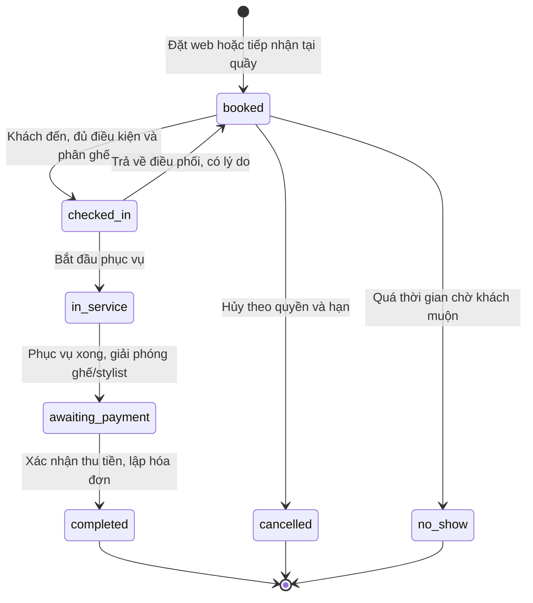
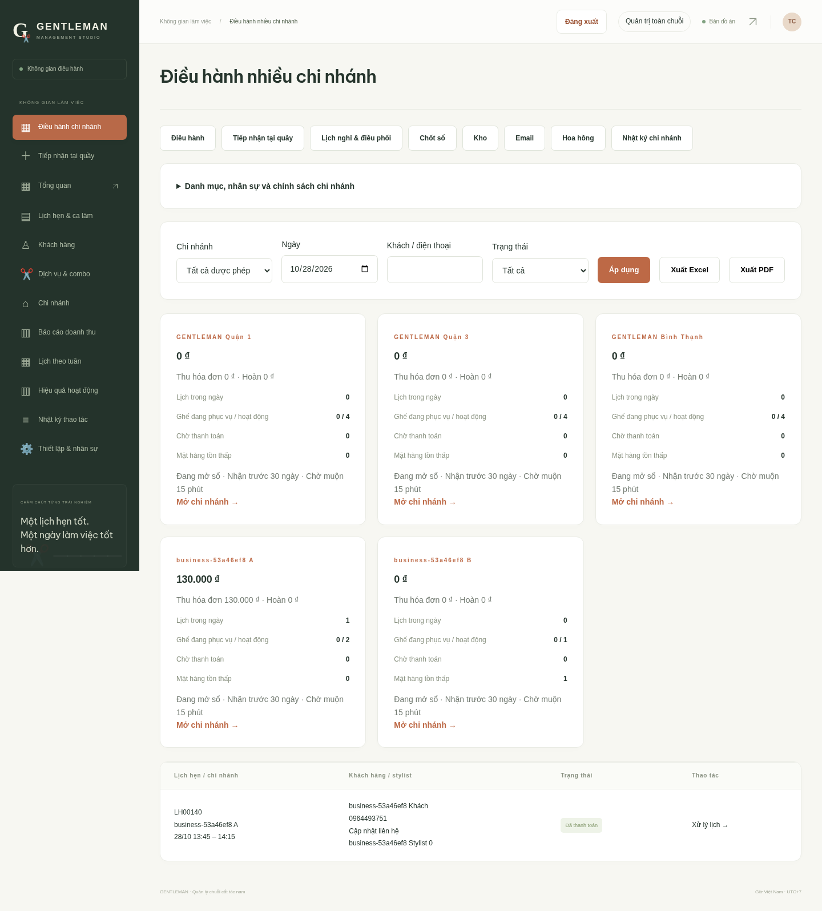
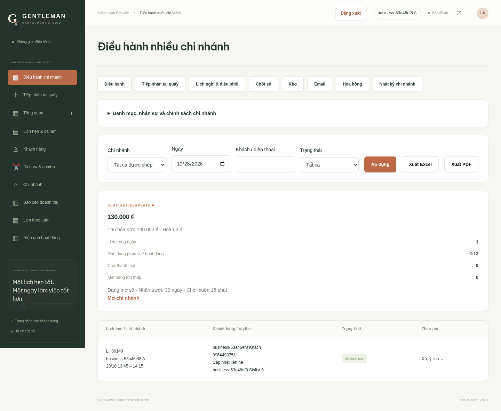
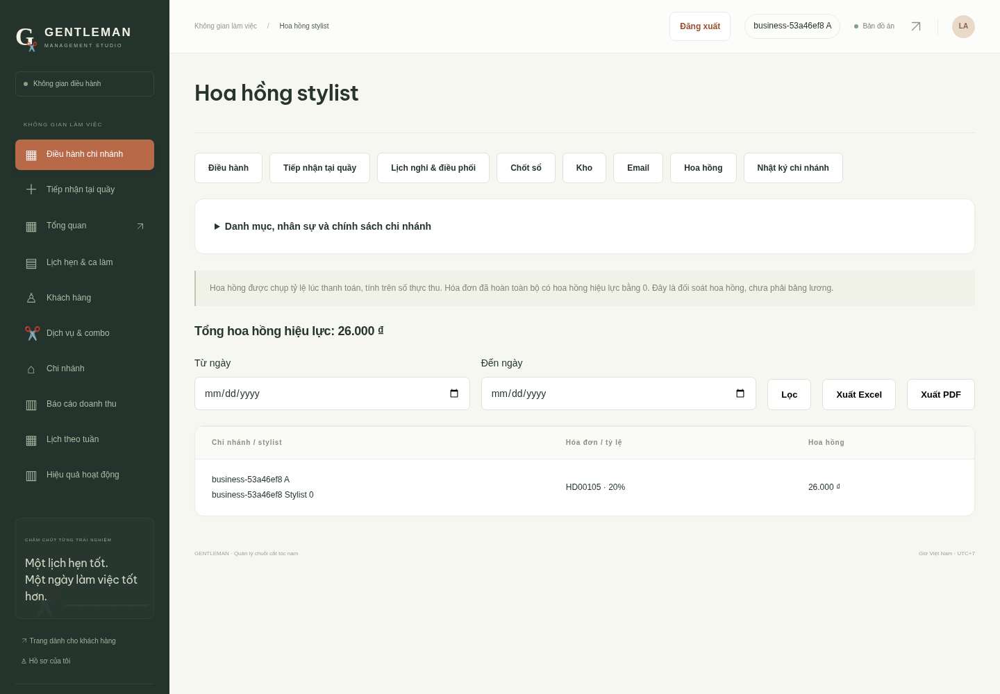

# Nghiệp vụ vận hành nhiều chi nhánh — 28/10/2026

Bản này hoàn thiện sáu nghiệp vụ đã thống nhất và bổ sung tài khoản stylist, voucher, kho từng chi nhánh, chuyển kho, hoa hồng, hoàn tiền và chốt sổ. Đây là hệ thống học tập chạy Django/PostgreSQL trực tiếp; tiền mặt và thẻ mô phỏng được ghi nhận nội bộ, không có kết nối ngân hàng hoặc hóa đơn điện tử thuế.

## 1. Cập nhật trên máy Windows / VS Code

Dừng Django bằng Ctrl+C. Từ thư mục chứa `manage.py`:

```powershell
# Nếu đã có lệnh backup_database từ bản trước, sao lưu trước khi cập nhật:
.\.venv\Scripts\python.exe manage.py backup_database

Invoke-WebRequest -Uri "https://raw.githubusercontent.com/tunato2807-del/ptpmhdtuong/main/scripts/cap_nhat_du_an.py" -OutFile ".\scripts\cap_nhat_du_an.py"
.\.venv\Scripts\python.exe scripts/cap_nhat_du_an.py
.\.venv\Scripts\python.exe -m pip install -r requirements.txt
.\.venv\Scripts\python.exe manage.py migrate
.\.venv\Scripts\python.exe manage.py check
.\.venv\Scripts\python.exe manage.py collectstatic --noinput
.\.venv\Scripts\python.exe manage.py runserver
```

**Phải migrate 0005/0006/0007 trước khi mở trang mới.** Sau khi chạy lại server, nhấn Ctrl+F5. Trình cập nhật lưu bản sao các file bị thay trong `.local/cap-nhat-…`, giữ `.env`, `.venv` và database. Cần lưu đủ cả file backup `.dump` và `.dump.json`.

Migration bổ sung cột và bảng, giữ nguyên lịch/hóa đơn/điểm hiện có. Với hóa đơn cũ, chỉ ghi số điểm đã tích khi có ledger chứng minh; không suy đoán điểm còn thiếu. Hoa hồng cũ được ghi 0 vì trước đó chưa lưu tỷ lệ. Thời gian phục vụ thực tế cũ để trống, không dựng thời gian giả.

## 2. Phạm vi quyền

| Vai trò | Được phép | Giới hạn |
|---|---|---|
| Quản trị toàn chuỗi (`manager`) | Xem mọi chi nhánh; tạo chi nhánh, bảng giá chung, sản phẩm; quản lý nhân sự; điều chuyển kho; điều hành và đối soát | Thay đổi có kiểm tra liên kết và lưu nhật ký |
| Quản lý chi nhánh (`branch_manager`) | Điều hành, cấu hình chính sách, stylist/ghế/ca, tài khoản lễ tân/stylist, voucher riêng, nhập/xuất kho, hoàn tiền, chốt sổ, hoa hồng và nhật ký trong chi nhánh được giao | Không tự tạo chi nhánh, không cấp quyền quản trị/quản lý, không tạo voucher toàn chuỗi hoặc chuyển kho sang chi nhánh khác |
| Lễ tân (`receptionist`) | Đặt hộ, tiếp nhận, check-in, điều phối, sửa dịch vụ, phục vụ/thu tiền, xem lịch/khách/báo cáo tại chi nhánh được giao | Không quản lý kho, lương/hoa hồng, voucher, tài khoản hoặc hoàn tiền/chốt sổ |
| Stylist (`stylist`) | Xem ca và lịch của chính mình, bắt đầu/hoàn tất phục vụ; xem hoa hồng tháng hiện tại của mình | Không thu tiền, không sửa danh mục, không xem lịch stylist/chi nhánh khác |
| Khách hàng (`customer`) | Lịch, hóa đơn, điểm, thông báo, đánh giá và thông tin cá nhân của mình | Không vào khu điều hành |

Quyền được kiểm tra trên máy chủ ở từng URL và giao dịch, không dựa vào việc ẩn nút. Các lệnh nhạy cảm đọc lại tài khoản khi giữ khóa chi nhánh. Quản trị cũ ở `/quan-ly/thiet-lap/` vẫn dành cho quản trị toàn chuỗi; quản lý chi nhánh dùng mục “Danh mục, nhân sự và chính sách chi nhánh” trong màn hình điều hành mới.

**Dữ liệu chung:** bảng giá dịch vụ, danh mục sản phẩm, hồ sơ và điểm khách hàng. **Dữ liệu theo chi nhánh:** nhân sự, ghế, ca, lịch nghỉ, lịch phục vụ, tồn kho, voucher riêng và sổ đối soát. Bảng giá hiện thống nhất toàn chuỗi. Lễ tân chỉ tra cứu danh sách khách từng có lịch tại chi nhánh mình.

## 3. Các địa chỉ chính

| Đường dẫn | Chức năng |
|---|---|
| `/quan-ly/van-hanh/` | Tổng hợp từng chi nhánh: lịch, ghế, chờ thu, thu/hoàn/ròng trong ngày, tồn thấp, trạng thái chốt sổ; lọc và xuất Excel/PDF |
| `/quan-ly/tiep-nhan/` | Tiếp nhận khách trực tiếp |
| `/quan-ly/lich-nghi/` | Stylist nghỉ, chi nhánh tạm nghỉ, danh sách lịch cần điều phối |
| `/quan-ly/chot-so/` | Đếm tiền, giải trình chênh lệch và chốt sổ ngày |
| `/quan-ly/kho/` | Nhập, xuất dùng, kiểm kê, chuyển kho, cảnh báo tồn và lịch sử |
| `/quan-ly/hoa-hong/` | Hoa hồng chụp tại thanh toán, lọc ngày và xuất Excel/PDF |
| `/quan-ly/email/` | Theo dõi thư xác nhận/nhắc lịch đang chờ, đã gửi, ngừng hoặc lỗi |
| `/quan-ly/nhat-ky-chi-nhanh/` | Nhật ký theo quyền chi nhánh |
| `/quan-ly/tai-nguyen/…/` | CRUD chi nhánh/chính sách, stylist, ghế, ca, tài khoản, sản phẩm, voucher |
| `/stylist/` | Cổng làm việc của stylist |
| `/kich-hoat-tai-khoan/` | Khách tại quầy xác minh email và đặt mật khẩu để truy cập hồ sơ |

Mở `http://127.0.0.1:8000/quan-ly/van-hanh/` sau khi đăng nhập tài khoản quản lý. Quản trị toàn chuỗi thấy các chi nhánh, quản lý/lễ tân thấy phạm vi được giao. Không có thêm tài khoản demo với mật khẩu cố định trong bản cập nhật này: quản trị tạo tài khoản theo nhu cầu.

## 4. Thiết lập một chi nhánh mới

1. Quản trị toàn chuỗi tạo chi nhánh, địa chỉ, điện thoại, giờ mở/đóng.
2. Tạo tài khoản quản lý chi nhánh và gắn đúng chi nhánh.
3. Tạo ghế hoạt động; chi nhánh chưa có ghế không nhận lịch.
4. Tạo tài khoản stylist vai trò `stylist`, sau đó gắn vào hồ sơ stylist cùng chi nhánh.
5. Thiết lập phần trăm hoa hồng (0–100), tạo ca làm trong giờ mở cửa.
6. Chọn số ngày nhận đặt trước (1–90, mặc định 30), hạn đổi/hủy (0–48 giờ, mặc định 2), thời gian chờ khách muộn (0–120 phút, mặc định 15).
7. Tạo sản phẩm/vật tư chung, nhập tồn tại chi nhánh; tạo voucher riêng nếu cần.
8. Đặt thử và thực hiện luồng tiếp nhận → phục vụ → thu tiền để kiểm tra thiết lập.

Tài khoản quản lý/nhân sự cần chi nhánh đang hoạt động. Tài khoản stylist chỉ gắn với một hồ sơ cùng chi nhánh. Chi nhánh của stylist/ghế đã tạo được giữ cố định để không đổi lịch sử; người quản lý xử lý lịch đang có trước khi ngừng nguồn lực.

## 5. Quy trình và trạng thái



### Tiếp nhận tại quầy

Chọn khách cũ tại chi nhánh hoặc nhập tên + điện thoại, email tùy chọn. Điện thoại hợp lệ được tra cứu để tránh tạo trùng hồ sơ; nếu đã tồn tại thì tên cần khớp, trường hợp nhiều hồ sơ trùng điện thoại cần quản trị xác minh. Chọn dịch vụ, stylist, giờ theo bước 15 phút. Toàn bộ tạo hồ sơ/lịch là một transaction; không còn hồ sơ rác nếu khung giờ vừa hết.

Hồ sơ khách mới tại quầy có mật khẩu chưa sử dụng, không tạo mật khẩu chung. Khách dùng “Kích hoạt tài khoản sau khi đến cửa hàng” trên trang đăng nhập; liên kết gửi đến email đã lưu cho phép đặt mật khẩu trong một giờ, dùng cơ chế token hiện có. Email có tên đăng nhập. Nếu chưa có email, lễ tân/quản lý dùng “Cập nhật liên hệ” từ danh sách khách hoặc lịch hẹn, xác minh khách và tích xác nhận trước khi bổ sung; không cho nhận hồ sơ chỉ bằng việc nhập một số điện thoại trên web.

### Sức chứa và giờ trống

Đồng thời kiểm tra ca, giờ mở cửa, stylist đang hoạt động, lịch nghỉ stylist/chi nhánh, ngày đã chốt sổ, thời lượng và lịch đã giữ. Một lịch được tính là chiếm một ghế trong toàn khoảng hẹn. Ghế được phân cụ thể khi check-in.

Dùng số ghế hoạt động và **số lịch đồng thời lớn nhất**, không cộng tất cả các lịch chỉ giao nhau một phần. Khoảng `[bắt đầu, kết thúc)` cho phép hai lịch tiếp giáp. Đặt lịch được khóa theo chi nhánh và xác thực lại; hai stylist không thể cùng chiếm chiếc ghế cuối. Việc tải giờ trống đọc theo lô dữ liệu ngày, không truy vấn lại database cho từng khung giờ.

### Khách sớm, muộn và dịch vụ kéo dài

- Check-in đúng ngày; sớm tối đa 15 phút.
- Sau thời gian chờ muộn của chi nhánh cần lý do; thời lượng dự kiến được kiểm tra lại theo giờ đến, nếu ảnh hưởng lịch sau thì phải đổi lịch trước.
- Không đến: lễ tân chỉ đánh dấu sau khi hết thời gian chờ; không tự hủy lịch khi tác vụ email chạy.
- Gia hạn lịch đang phục vụ theo 15/30/45/60 phút, có lý do, kiểm tra ca/ghế/lịch tiếp theo. Nếu xung đột thì điều phối lịch trước; không tự đẩy giờ khách khác.

### Nghỉ đột xuất và điều phối

Quản lý tạo khoảng nghỉ + lý do, chọn stylist hoặc toàn chi nhánh. Hệ thống chặn lịch mới, thông báo cho khách bị ảnh hưởng và ngừng nhắc lịch của các lịch đó. Lịch cũ vẫn được giữ để quản lý nhìn thấy và liên hệ.

Với lịch chưa check-in, chọn “Đổi lịch / stylist”, xem giờ trống, xác nhận giờ/người mới; giữ mã và giá đã đặt. Với khách đã check-in, chọn “Trả về chờ điều phối” có lý do rồi đổi lịch hoặc hủy. Lịch đang phục vụ được xử lý hoàn tất thực tế; không đảo ngược lịch đã thu tiền. Chỉ ngừng hiệu lực lịch nghỉ bằng POST; lịch sử nghỉ không xóa.

### Dịch vụ phát sinh

Trước khi hoàn tất phục vụ, lễ tân chọn danh sách dịch vụ sau điều chỉnh, nhập lý do và xác nhận khách đồng ý. Dòng giữ nguyên dùng giá/thời lượng snapshot cũ; dòng mới dùng giá hiện tại. Tính lại toàn bộ khoảng phục vụ, kiểm tra xung đột và lưu lịch sử trước/sau. Không sửa dịch vụ sau khi chuyển sang chờ thu hoặc đã thu tiền.

### Hoàn tất và thu tiền

Stylist/lễ tân bấm “Hoàn tất phục vụ”, ghi thời điểm thực tế, chuyển chờ thanh toán và giải phóng nguồn lực. Thu ngân kiểm tra phương thức, điểm hoặc voucher, xem số cần thu từ máy chủ rồi xác nhận đã nhận tiền. Máy chủ kiểm tra lại báo giá tại transaction; nếu số tiền đã đổi thì yêu cầu xem lại, không ghi hóa đơn với báo giá cũ.

Mỗi lịch chỉ có một hóa đơn. Điểm, voucher và hoa hồng ghi cùng transaction. Tiền mặt/thẻ mô phỏng không tạo giao dịch ngân hàng.

## 6. Voucher, điểm và hoa hồng

- Voucher giảm tiền cố định, có khoảng hiệu lực, hóa đơn tối thiểu, giới hạn tổng lượt; mỗi khách dùng mỗi mã một lần.
- Voucher có thể cho toàn chuỗi (quản trị) hoặc một chi nhánh. Kiểm tra chi nhánh, thời hạn và lượt còn lại cả khi báo giá và thu tiền. Khóa voucher khi dùng để không vượt lượt cuối giữa hai chi nhánh.
- Không cộng dồn voucher và giảm bằng điểm. Điểm giảm tối đa 20%; 1 điểm = 1.000đ; mỗi 10.000đ thực thu tích 1 điểm.
- Voucher đã có giao dịch giữ nguyên mã, chi nhánh và giá trị; có thể ngừng hoặc chỉnh thời hạn/lượt.
- Hoa hồng = thực thu × tỷ lệ stylist tại lúc thanh toán, làm tròn xuống đồng. Đổi tỷ lệ hôm nay không thay hóa đơn cũ. Hóa đơn hoàn toàn bộ có hoa hồng hiệu lực bằng 0; bảng này chưa bao gồm lương cơ bản, thuế hoặc trả lương.

## 7. Kho theo chi nhánh

Quản trị quản lý danh mục sản phẩm/vật tư chung, đơn vị và ngưỡng cảnh báo. Tạo qua danh mục mới sẽ khởi tạo tồn 0 cho các chi nhánh hiện có; dữ liệu tồn phát sinh từ giao dịch.

| Loại | Quy tắc |
|---|---|
| Nhập kho | Số lượng dương, có lý do/chứng từ |
| Xuất sử dụng | Số lượng dương; không đủ tồn thì từ chối |
| Kiểm kê | Nhập chênh lệch có dấu, không nhập số đếm thay cho chênh lệch; tồn sau không âm |
| Chuyển kho | Quản trị toàn chuỗi chọn hai chi nhánh khác nhau; khóa theo thứ tự ID; trừ/cộng trong cùng transaction, cùng mã phiếu |

Mỗi giao dịch lưu người thao tác, thời gian, chênh lệch và tồn sau. Không chỉnh sửa/xóa bút toán; sai thì lập giao dịch điều chỉnh có lý do. Có cảnh báo tồn thấp, tra lịch sử và xuất Excel/PDF. Đây là kho vật tư phục vụ salon, chưa là phân hệ bán lẻ sản phẩm hoặc quản lý nhà cung cấp/công nợ.

## 8. Hoàn tiền, chốt sổ và báo cáo

Quản lý trong phạm vi chi nhánh ghi nhận hoàn **toàn bộ** số thực thu, bắt buộc lý do và xác nhận đã trả tiền khách. Một hóa đơn chỉ hoàn một lần. Không sửa hóa đơn gốc, không trả lại lượt voucher. Nếu điểm tích đã dùng, thu hồi số có thể thu; phần thiếu ghi `points_debt`, bù bằng điểm tích ở lần thanh toán sau. Số điểm khả dụng không âm và khách chưa được đổi điểm khi còn nợ điểm.

Thu ròng theo kỳ = tổng hóa đơn có `paid_at` trong kỳ − hoàn tiền có `created_at` trong kỳ, kể cả hoàn cho hóa đơn kỳ trước. File Excel/PDF/CSV báo cáo giao dịch có dòng hoàn âm. Các bảng phân bổ theo dịch vụ/stylist vẫn là thu hóa đơn trước hoàn và ghi rõ ý nghĩa.

Chốt sổ ngày: tiền mặt hệ thống = tiền mặt thu − tiền mặt hoàn trong ngày; không tính tiền đầu ca hoặc giao dịch thẻ. Quản lý nhập số thực đếm, bắt buộc giải trình nếu chênh lệch. Cần xử lý xong các lịch đang chờ/đang phục vụ/chờ thanh toán của ngày đó trước khi chốt. Chốt một lần/chi nhánh/ngày; sau chốt không thu/hoàn hoặc nhận thêm lịch phục vụ trong ngày đã chốt. Không xóa/sửa bản chốt.

Hoàn tiền một phần, mở lại sổ, trả lương, công nợ nhà cung cấp và điều chuyển lịch đã phục vụ sang chi nhánh khác chưa nằm trong quy trình này; khi cần phải thêm chứng từ và quyền duyệt tương ứng.

## 9. Gửi email và nhắc lịch trên Windows

Mặc định DEBUG dùng email file tại `.local/emails` để trình diễn. Muốn gửi Gmail thật, điền trên máy của bạn vào `.env` (không gửi mật khẩu lên GitHub/chat):

```dotenv
EMAIL_BACKEND=django.core.mail.backends.smtp.EmailBackend
EMAIL_HOST=smtp.gmail.com
EMAIL_PORT=587
EMAIL_USE_TLS=1
EMAIL_HOST_USER=diachi-cua-ban@gmail.com
EMAIL_HOST_PASSWORD=MAT_KHAU_UNG_DUNG_CUA_BAN
DEFAULT_FROM_EMAIL=Gentleman <diachi-cua-ban@gmail.com>
```

Khởi động lại Django sau khi sửa. Gmail cần cấu hình tài khoản phù hợp, thường dùng xác minh hai bước và mật khẩu ứng dụng. Bản cập nhật không tự nhập thông tin hay gửi thư thật ra ngoài trong kiểm thử.

Xem số thư đến hạn rồi chạy gửi:

```powershell
.\.venv\Scripts\python.exe manage.py dispatch_emails --dry-run
.\.venv\Scripts\python.exe manage.py dispatch_emails --limit 100
```

Tác vụ tạo thư nằm trong transaction đặt/đổi/hủy trạng thái. Nhắc trước 24 giờ và 2 giờ chỉ được tạo nếu thời điểm nhắc còn trong tương lai. Đổi/hủy/check-in/lịch nghỉ sẽ ngừng nhắc cũ. Tác vụ gửi kiểm tra lại trạng thái và khoảng nghỉ, bỏ thư hết hiệu lực. Lỗi được thử lại có khoảng chờ, tối đa 5 lần; giữ trạng thái để người quản lý biết.

Để chạy tự động, mở **Task Scheduler → Create Task** trên Windows:

1. Trigger lặp mỗi 1 phút khi máy đang hoạt động.
2. Program: đường dẫn đầy đủ tới `.venv\Scripts\python.exe` trong dự án.
3. Arguments: đường dẫn đầy đủ tới `manage.py`, tiếp theo `dispatch_emails --limit 100`.
4. Start in: thư mục dự án có `.env` và `manage.py`; thử Run, xem `/quan-ly/email/` và lịch sử task.

Máy cần bật và PostgreSQL hoạt động để nhắc đúng giờ. Khóa hàng `skip_locked` ngăn hai worker cùng nhận một thư. SMTP không có giao dịch chung với database: nếu tiến trình dừng ngay sau SMTP thành công nhưng trước khi đánh dấu đã gửi, có thể gửi lại; không tuyên bố bảo đảm exactly-once với nhà cung cấp bên ngoài.

## 10. Kịch bản nghiệm thu

| Tình huống | Kết quả cần đạt |
|---|---|
| Hai stylist nhưng một ghế, hai khách đặt cùng lúc | Một lịch thành công, lịch kia chọn giờ khác |
| Hai lịch liên tiếp 10:00–10:30, 10:30–11:00 và ghế thứ hai trống | Có thể nhận thêm lịch 10:00–11:00 ở ghế thứ hai |
| Khách tại quầy chưa có tài khoản | Tạo hồ sơ, tiếp nhận, phục vụ; email kích hoạt giữ đúng lịch sử |
| Stylist nghỉ có lịch đã đặt | Lịch xuất hiện trong danh sách ảnh hưởng; đổi stylist còn trống, giữ mã/giá |
| Khách đã check-in cần đổi stylist | Trả về chờ điều phối, có lý do; đổi và phân ghế lại |
| Thêm dịch vụ kéo dài vào lịch tiếp theo | Từ chối và giữ nguyên dịch vụ/lịch cũ |
| Stylist hoàn tất | Giải phóng ghế, chưa tạo hóa đơn; thu ngân thu ở bước sau |
| Hai chi nhánh tranh lượt voucher cuối | Một hóa đơn dùng được, một hóa đơn phải đổi phương án giảm |
| Hai người xuất 7 từ tồn 10 | Một thành công; tồn còn 3, không âm |
| Chuyển 2 chai từ A sang B | A giảm 2, B tăng 2, hai dòng cùng mã phiếu |
| Hoàn hóa đơn sau khi khách đã dùng điểm tích | Giữ hóa đơn, ghi hoàn và điểm cần thu hồi, hoa hồng hiệu lực 0 |
| Lễ tân/quản lý A sửa URL sang B | Không lấy được hoặc không sửa được dữ liệu ngoài quyền |
| Chốt sổ còn khách chờ thu | Từ chối; sau khi xử lý hết mới chốt |

Bằng chứng chạy tại [validation/13-NGHIEP-VU.txt](validation/13-NGHIEP-VU.txt). Kiểm thử dùng PostgreSQL thật và database test riêng; browser dùng dữ liệu tổng hợp riêng và dọn sau chạy. Chưa kiểm chứng SMTP thật, Windows Task Scheduler thực tế, hệ thống ngân hàng hoặc tải sản xuất.

## 11. Các file để copy

Dùng công cụ cập nhật là cách lấy đủ các file liên quan. Nếu copy từng file, lấy nguyên file từ GitHub:

- Dữ liệu: [models.py](../salon/models.py), toàn bộ [migrations/0005–0007](../salon/migrations).
- Lõi nghiệp vụ: [services.py](../salon/services.py), [scheduling.py](../salon/scheduling.py), [business.py](../salon/business.py), [events.py](../salon/events.py), [messaging.py](../salon/messaging.py).
- Màn hình và quyền: [business_forms.py](../salon/business_forms.py), [business_views.py](../salon/business_views.py), [activation.py](../salon/activation.py), [forms.py](../salon/forms.py), [views.py](../salon/views.py), [features.py](../salon/features.py), [operations.py](../salon/operations.py), [urls.py](../salon/urls.py), [checks.py](../salon/checks.py).
- Email: [dispatch_emails.py](../salon/management/commands/dispatch_emails.py).
- Giao diện: [templates/business](../templates/business), [base.html](../templates/base.html), [staff/base.html](../templates/staff/base.html), [staff/customers.html](../templates/staff/customers.html), [auth/login.html](../templates/auth/login.html), [booking.html](../templates/public/booking.html), [appointment_detail.html](../templates/public/appointment_detail.html), [invoice.html](../templates/public/invoice.html), [features/reports.html](../templates/features/reports.html), [features/reschedule.html](../templates/features/reschedule.html), [operations/points.html](../templates/operations/points.html), [operations/performance.html](../templates/operations/performance.html).
- Tài nguyên: [business.css](../static/css/business.css), [app.js](../static/js/app.js).






